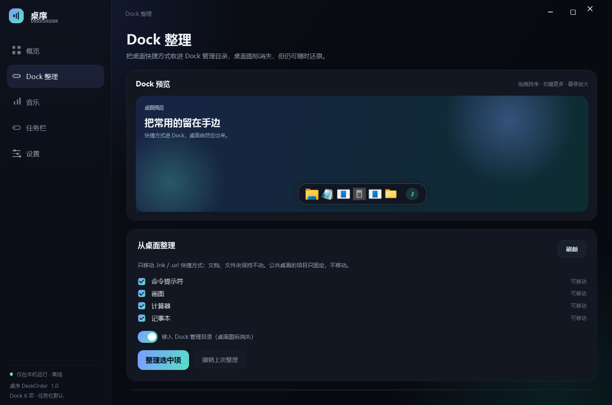
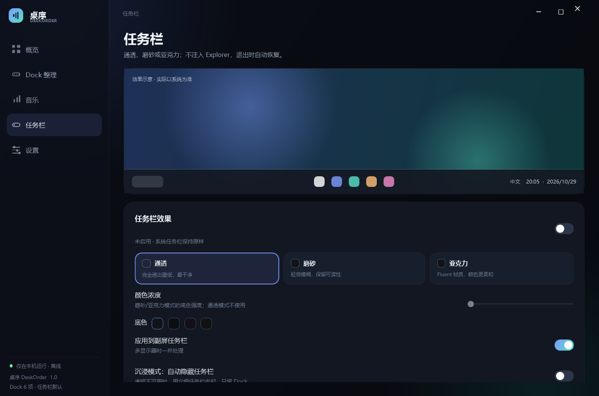
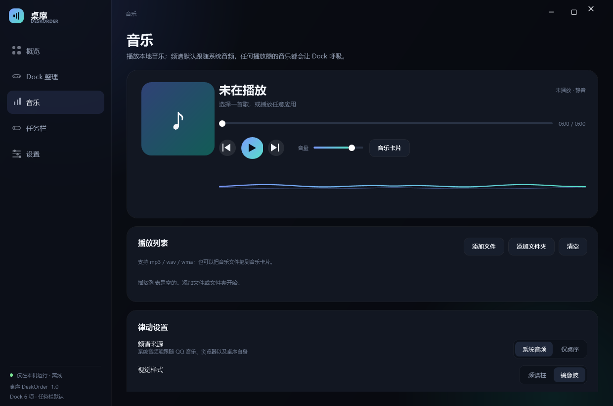
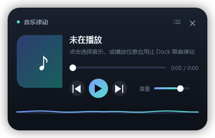
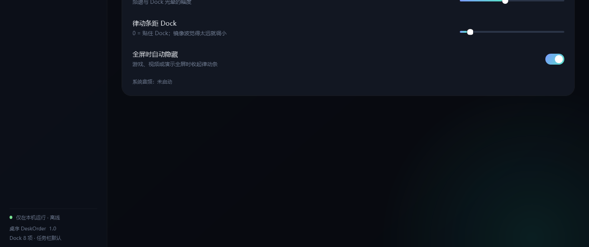

# 桌序 DeskOrder

> Dock 整理 · 任务栏透明 · 音乐律动  
> 一个单文件、离线、无需管理员的 Windows 桌面小工具。


---

## 它解决什么问题

桌面上的快捷方式越来越多，任务栏挡住壁纸，音乐播放器又一个比一个笨重。  
桌序把这三件事放进一个小工具：

- **Dock**：常用应用、文件夹、文件直接固定在底部；悬停放大，点击启动，拖拽排序。
- **Dock 整理**：把桌面快捷方式收进 Dock 管理目录，桌面变干净；随时可以移回。
- **任务栏透明**：通透 / 磨砂 / 亚克力三种效果，可预览、可恢复。
- **音乐律动**：内置本地播放器 + 跟随系统音频的频谱；Dock 光晕会跟着低音呼吸。
- **纯净桌面**：隐藏全部桌面图标，只留下壁纸、Dock 和任务栏。


---

## 快速开始

1. 双击 `dist\桌序.exe`（或同目录的 `DeskOrder.exe`，内容相同）。
2. 第一次启动会打开控制中心；关闭窗口后会最小化到托盘，底部 Dock 出现。
3. 托盘菜单可以随时打开主界面、显示/隐藏 Dock、打开音乐卡片或退出。
4. 主界面左侧依次是：**概览 / Dock 整理 / 音乐 / 任务栏 / 设置**。

系统要求：Windows 10 1809+ / Windows 11 x64，系统自带 .NET Framework 4.8。  
不需要安装、不需要管理员，不会联网。

> 当前验收环境：Windows 11 build 26300，2560×1440 @125%，后台有常驻程序在运行。

---

## Dock



- 首次运行会把桌面 `.lnk/.url` **仅固定**到 Dock（不移动文件），方便立刻看到效果。
- 图标支持悬停放大、运行状态光点、点击启动；已运行的窗口会尝试恢复并前置。
- 拖入任意 EXE / LNK / URL / 文件夹 / 文件即可固定；**Dock 内拖拽即可排序**。
- 右键图标：打开 / 在文件夹中显示 / 更换图标 / 左移 / 右移 / 从 Dock 移除。
- **右键 Dock 空白处**：添加文件… / 添加文件夹… / 按名称整理 / 打开 Dock 整理。
- Dock 整理页右上角也有「添加文件… / 添加文件夹… / 按名称整理」，每行 `↑ ↓ ×` 直接调整顺序和删除。
- 设置里可调整图标大小、间距、底板不透明度、自动隐藏、悬停放大、全屏避让、音乐按钮。
- 屏幕空间不足时会自动缩小图标；仍不够时可以用滚轮横向滚动。
- Dock 窗口现在与底板**严丝合缝**，没有外层透明框；用 Win32 物理坐标固定在任务栏上方，显示/隐藏后不会滑到任务栏下面。
- 主窗口打开或全屏应用运行时自动让位；全屏时窗口会完全移出屏幕，不再留下一条透明边。

### 为什么 WPS 能打开，QQ / 浏览器不行？

这是旧版启动逻辑的典型差异，不是 Dock 点击没生效：

- **WPS** 是普通的 `.lnk → exe`，没有特殊参数；`ShellExecute` 直接启动，所以看起来正常。
- **QQ / 浏览器** 常见两种情况：
  1. 进程已经在运行。旧逻辑先尝试“聚焦已有窗口”；Windows 的前台锁会让 `SetForegroundWindow` 静默失败，但旧代码仍当成成功，于是**不再启动**。WPS 没在运行，所以能开。
  2. Store / UWP 版快捷方式的目标是 `explorer.exe`，真正的 AppID 放在 `shell:AppsFolder\...` 参数里。旧逻辑只解析出 `explorer.exe`，就误以为“应用已在运行”，去聚焦资源管理器，实际应用没打开。
- 浏览器的快捷方式还可能带 `--profile-directory` 等参数；只取目标 exe 会丢掉这些参数。

新版改成：**`.lnk` / `.url` 直接交给 ShellExecute**，保留参数、工作目录和 UWP/AppID；只有普通 exe 才尝试聚焦，且会检查 `SetForegroundWindow` 的返回值。若仍打不开，日志会记录 `Launched ... via shell shortcut` 或异常，便于定位。

### 整理桌面

- 打开 **Dock 整理 → 从桌面整理**，勾选要收起的快捷方式。
- 默认“移入 Dock 管理目录”：桌面图标消失，文件移动到  
  `<配置目录>\DockItems`，Dock 继续可用。
- **不会删除任何文件**。每条记录都可以“移回桌面”，也支持撤销上一次整理。
- 公共桌面（`C:\Users\Public\Desktop`）的项目没有写权限，只固定、不移动。
- 文档、文件夹不会被移动；需要的话可以直接固定到 Dock。
- 设置页的“纯净桌面”可以隐藏全部桌面图标，退出桌序时自动恢复。

### 为什么“删除 / 移动 / 添加”会像没反应？（已修复）

如果桌序是从受限环境启动的（沙箱、受限令牌、低完整性），`%APPDATA%\DeskOrder` 是**不可写**的。旧版把 `pins.json` 的保存放在 UI 刷新之前，写入失败会抛异常并被全局处理器吞掉，于是：

- 点 `×`：内存里已经删了，但页面和 Dock 都没刷新，看起来“删不掉”；
- 点 `↑ ↓` / 拖拽排序：同上，顺序没变；
- 点整理 / 添加：直接中断，连提示都没有。

现在：

1. 启动时按 `%APPDATA%` → `%LOCALAPPDATA%` → exe 同级 `DeskOrderData\` → `%TEMP%\DeskOrder` 顺序**探测可写目录**，用第一个能真正写入的；日志会记录 `data root=... writable=True requested=...`，界面也会提示一次。
2. 保存失败不再中断操作：改动立即生效并写入事件，失败信息通过 `Dock.LastSaveError` 显示成提示（“改动已生效，但无法保存到 …”）。
3. `--data-info` 可以随时查看当前用的是哪个目录、是否可写。

Dock 内的拖拽排序还有一个独立缺陷：接收拖放的 `DragEnter` 只允许 `FileDrop`，内部固定项拖动（`DeskOrder.Pin`）被判为 `None`，所以**从 Dock 内部拖图标永远不会排序**。现在按数据类型分别返回 `Move` / `Copy`。

---

## 任务栏



- 三种模式：**通透 / 磨砂 / 亚克力**；支持主任务栏与副任务栏。
- “预览 8 秒”会临时应用并自动还原，适合先确认兼容性。
- 可恢复默认；退出桌序时默认自动恢复。
- 任务栏效果现在会**递归应用到内容层**（包括 26H2 的 XAML 内容桥），并用“修复显示”请求重绘。
- **沉浸模式**：如果系统仍拒绝透明，可一键让任务栏自动隐藏，只保留 Dock。
- 不注入 Explorer、不替换系统组件、不自动重启资源管理器。

> **重要**：Windows 11 24H2 之后的 XAML 任务栏经常拒绝 accent policy；这是系统限制，不是所有机器都能改。  
> 请先用“预览 8 秒”确认；如果没有任何变化，打开 **沉浸模式** 作为可用替代。  
> 详细说明和手动验证步骤见 [验证报告](artifacts/verification.md)。

---

## 音乐与律动







- 本地播放：**mp3 / wav / wma**（使用 Windows MCI 解码，不依赖 Media Player 组件）。
- 支持添加文件/文件夹、拖放、删除、清空；记住播放列表、音量、循环方式和上次播放位置。
- 频谱默认采集 **系统回环音频**：QQ 音乐、浏览器或桌序自身的音乐都会让 Dock 呼吸。
- 也可以切到“仅桌序”，只跟随内置播放器。
- **桌面默认只显示一条透明的律动条**：没有卡片、没有底板、没有边框，只有频谱；鼠标可穿透，启动即出现，位于 Dock 上方。
- 音乐页可关闭“桌面透明律动条”；完整音乐卡片仍可从 Dock 的音乐按钮或托盘打开。
- 频谱样式：频谱柱 / 镜像波；强度可调；没有声音时进入缓慢呼吸。
- **“律动条距 Dock”滑条**：0 = 贴住 Dock，最大 160；镜像波觉得太远就调小，频谱柱建议留一点距离。
- **“全屏时自动隐藏”**：游戏、视频或演示全屏时自动收起律动条，退出全屏后自动恢复。
- **不录音、不保存音频、不使用麦克风**；采集只存在于内存，用于计算频谱。

---

## 快捷键与托盘

| 操作 | 默认 |
|---|---|
| 显示 / 隐藏 Dock | `Ctrl + Alt + D` |
| 显示 / 隐藏音乐卡片 | `Ctrl + Alt + M` |
| 打开音乐库 | 音乐卡片右上角列表按钮 |
| 退出 | 托盘菜单 → 退出 |

- 快捷键可在设置中关闭；被其他程序占用时不会影响其他功能。
- 关闭主窗口默认最小化到托盘；Dock 继续运行。
- 可在设置中开启开机启动，见下节。

### 开机启动

设置页的「开机启动桌序」会按下面的顺序登记，成功一个就停：

1. **当前用户注册表 Run 项**（`HKCU\Software\Microsoft\Windows\CurrentVersion\Run`）——最标准，能在「任务管理器 → 启动应用」里看到；
2. **当前用户「启动」文件夹**快捷方式（`%APPDATA%\Microsoft\Windows\Start Menu\Programs\Startup\DeskOrder.lnk`）——注册表被策略或安全软件挡住时的退路；
3. **登录计划任务**（`schtasks /SC ONLOGON /TN DeskOrder`）——前两条都失败时的退路。

- 三种方式都失败时，设置页会把每一层的原因写出来（含当前进程的完整性级别），托盘提示「无法修改开机启动项」，不会假装成功。
- 如果登记项被 Windows 自己的「启动应用」开关关掉（`StartupApproved\Run`），状态行会显示「已被 Windows「启动应用」关闭」，点「重新登记」即可恢复。
- 换了目录、改名或重新解压后，桌序每次启动都会把登记项里的路径刷成当前 exe；发现指向旧路径时设置页会提示，并给出「重新登记」。
- 当前运行环境不允许写注册表时（低完整性/沙箱会话、受限令牌），用设置页的「复制启动命令」把一行 PowerShell 命令贴到**普通**窗口里执行：

  ```powershell
  Set-ItemProperty -Path 'HKCU:\Software\Microsoft\Windows\CurrentVersion\Run' -Name 'DeskOrder' -Value ('"' + '<exe 路径>' + '" --tray')
  ```

- 命令行诊断：`桌序.exe --startup status` 打印 `enabled / mechanism / stale / osDisabled / runKeyWritable / integrity / problem`；`--startup on|off|repair` 直接登记、取消或重新登记。

---

## 数据放在哪里

```
<配置目录>\
  settings.json          设置
  pins.json              Dock 固定项
  desktop-imports.json   桌面快捷方式移动记录
  playlist.json          播放列表
  DockItems\             被收进 Dock 的快捷方式
  Icons\                 自定义 Dock 图标
  logs\                  日志
  local\cache\           图标/封面缓存
```

`<配置目录>` 的确定顺序（启动时实际创建并写探针文件，取第一个成功的）：

1. **便携模式**：exe 同级存在 `portable.txt` 时，用 `exe\DeskOrderData\`
2. `%APPDATA%\DeskOrder`
3. `%LOCALAPPDATA%\DeskOrder`
4. `exe\DeskOrderData\`（可写时）
5. `%TEMP%\DeskOrder`

用 `.\dist\DeskOrder.exe --data-info` 可以打印实际使用的目录与探测结果（含 `portable` 字段）。桌序不上传任何数据，也没有网络访问。

---

## 打包发布

```powershell
powershell -ExecutionPolicy Bypass -File .\package.ps1
```

产物：

```
release\
  DeskOrder-1.0.0-portable\        解压后使用者看到的目录
    DeskOrder.exe                主程序
    桌序.exe                      同名副本（文件名乱码时用）
    portable.txt                 便携模式标记 → 数据存在同目录 DeskOrderData
    使用说明.txt                  给使用者的说明
    README.md                     完整功能/设计说明
    SHA256.txt                    校验值
  DeskOrder-1.0.0-portable.zip    直接发给别人的压缩包（约 340 KB）
```

打包要点：

- exe 是**绿色便携**的：解压即可运行，数据默认落在程序旁边的 `DeskOrderData`；删掉 `portable.txt` 就回到 `%APPDATA%\DeskOrder`。
- 压缩包内的中文文件名按 **UTF-8 + UTF-8 标志位（bit 11）** 写入。注意：`ZipFile.CreateFromDirectory` **不能**显式传 `UTF8Encoding` —— 那样只会写 UTF-8 字节而不置标志位，资源管理器/7-Zip 解压出来会全是乱码；不传编码参数时 .NET 才会正确置位（已实测，见验证记录第 11 节）。
- 包内的 `使用说明.txt` 与 `README.md` 会重新编码为 **带 BOM 的 UTF-8**，避免旧版记事本/写字板把中文显示成乱码。
- exe 未做代码签名，别人首次运行会看到 SmartScreen 蓝框，`使用说明.txt` 里写了「更多信息 → 仍要运行」的说明。
- 使用者不需要装 VC++ 运行库；需要 .NET Framework 4.8（Win10 1903+ / Win11 自带）。

---

## 构建

需要 Windows 自带的 .NET Framework 4.8 编译器（无需 Visual Studio / Node / NuGet）：

```powershell
powershell -ExecutionPolicy Bypass -File .\build.ps1
```

产物：`dist\DeskOrder.exe`。当前交付版同时保留了 `dist\桌序.exe` 副本。

构建脚本会：
1. 用 `assets\app.ico` 作为应用图标；
2. 用 `src\app.manifest` 启用 PerMonitorV2 DPI 与普通用户权限；
3. 以 C# 5 语法编译全部 `src\**\*.cs`；
4. 生成单文件 exe（约 314 KB）。

---

## 自检与验证

```powershell
.\dist\DeskOrder.exe --self-test artifacts\final-selftest.json
.\dist\DeskOrder.exe --player-test artifacts\final-player.json
.\dist\DeskOrder.exe --audio-test artifacts\final-audio.json
.\dist\DeskOrder.exe --dock-ui-test artifacts\dock-ui-test.json
.\dist\DeskOrder.exe --dock-save-test artifacts\dock-save-test.json
.\dist\DeskOrder.exe --data-info --report artifacts\data-info.json
.\dist\DeskOrder.exe --startup status
.\dist\DeskOrder.exe --startup repair
.\dist\DeskOrder.exe --screenshot-ui artifacts\ui-final --size 1240x820
.\dist\DeskOrder.exe --launch-test "C:\path\to\app.lnk" --report artifacts\launch.json
```

- `--launch-test`：用真实的 Dock 启动逻辑打开一个快捷方式或 exe，报告是否抛错、解析到的目标以及前后进程数。
- `--dock-ui-test`：**不需要物理鼠标**，直接构造主窗口与 Dock 窗口，用合成事件点击真实的 `↑ ↓ ×`、调用添加/拖放/排序逻辑，并核对 `pins.json` 的落盘顺序。
- `--dock-save-test`：把配置目录指到一个只读路径，验证“保存失败也不会中断操作，并且会报告原因”。
- `--data-info`：打印配置目录探测链、是否可写、是否便携模式。
- `--startup status`：打印开机启动的登记状态（机制、是否指向旧路径、是否被系统关掉、注册表是否可写、当前进程完整性级别、失败原因）；`--startup on|off|repair|command` 直接登记 / 取消 / 重新登记 / 打印启动命令行。
- `--desktop-dir <目录>`：把桌面扫描指向指定目录（同时忽略公共桌面），用于测试与截图。

仓库里的 `preview/` 截图就是这样重新渲染的：先准备一份中性示例数据目录（`pins.json` 里是记事本/画图/计算器一类系统程序）和一份只有几个假快捷方式的目录，再执行
`--screenshot-ui preview --size 1240x820 --data-dir <示例数据> --desktop-dir <示例桌面>`，
以免把本机桌面上的真实内容带进仓库。

当前结果：

- 构建成功，exe 321,536 字节（约 314 KB），`dist\DeskOrder.exe` 与 `dist\桌序.exe` SHA256 一致。
- 自检 **24/24** 通过：FFT、频段映射、配置规范化、JSON 往返、桌面快捷方式枚举、导入/撤销、Dock 增删改排、配置目录回退、便携模式识别与初始化、拖放效果规则、只读目录下保存失败可上报、DefView、图标提取、任务栏颜色编码、开机启动命令行与 `StartupApproved` 解析、启动快捷方式往返、开关失败必给原因、启动状态可读、界面路径打码。
- Dock 整理 UI 测试 **22/22** 通过：页面上的移动、删除、添加、重复/缺失文件处理、落盘顺序、拖放效果、Dock 内拖拽排序、文件拖入、空位菜单、按名称整理。测试会在开始时快照数据目录、结束时还原，因此对真实配置目录运行也不会破坏用户的 `pins.json`（已用 SHA256 前后比对实测）。
- 开机启动实测：登记到 `HKCU\...\Run` 的值为 `"<exe>" --tray`，`--startup status` 报告 `enabled: true / mechanism: 注册表 Run 键 / osDisabled: false`；在低完整性会话里同一命令报告 `runKeyWritable: false`、`problem` 说明原因（这正是之前开关「点了没反应」的原因）。
- 只读配置目录实测：`threw: false`、`opsSurvived: true`、`saveErrorReported: DirectoryNotFoundException...`。
- 发布包实测：解压后直接运行 `DeskOrder.exe`，`portable: true`、数据落在同目录 `DeskOrderData`，`ERROR=0 WARN=0`，无多余提示；压缩包内 `桌序.exe` / `使用说明.txt` 解压后文件名正常。
- 本地播放器：WAV 播放成功，进度 0.576 s，循环/暂停/跳转链路正常。
- 系统音频回环：FFT 正弦测试通过；440 Hz 测试音在目标频段能量 0.318（基线 0.155），律动链路可用。
- UI 在 1240×820 与 1240×1400 下渲染检查无裁切；预览图见 `preview/`。
- 桌面律动条实测：距离 0 贴住 Dock、60 为 60 px、默认 12；全屏时隐藏、退出全屏回原位；Dock 全屏移出屏幕时律动条留在原位。
- 快捷方式启动实测：`.lnk` 连续点击两次都会执行（参数、工作目录保留），普通 exe 走聚焦/启动链路，均无异常。
- 单实例实测：第二次启动会退出，不会产生第二个 Dock。
- 物理鼠标注入在当前 Low Integrity 会话被阻止；文件/文件夹选择器、托盘菜单、SmartScreen 需要实机点一次确认。

更完整的记录见 [artifacts/verification.md](artifacts/verification.md)。  
在普通桌面会话中，如果任务栏没有变化，可双击 `tools\verify-taskbar.cmd` 做一次 8 秒探针，并查看它打印的日志路径。

---

## 已知限制

- 任务栏透明依赖 Windows 版本；24H2 之后的 XAML 任务栏可能拒绝 accent policy。请先使用“预览 8 秒”；仍无效时用“沉浸模式：自动隐藏任务栏”。
- 恢复任务栏如果出现发黑，使用“修复显示”；无效时可重新应用或重启资源管理器（桌序不会自动执行）。
- 本地音乐只保证 mp3 / wav / wma；FLAC / M4A / AAC 未纳入 MCI 测试范围。
- Dock 不支持 UWP 应用固定、嵌套分组或鼠标穿透。
- 从 Dock 或 Dock 整理页添加时，文件选择器里可以直接选 exe / lnk / url / 文件夹；UWP 应用请固定它的桌面快捷方式。
- 任务栏透明在 26H2 上可能被系统直接拒绝；沉浸模式是替代方案，不是真正的透明。
- 不支持按单个图标隐藏，只提供“全部图标”开关。
- 当前没有自动更新、安装包、签名和英文界面。
- 开机启动需要**至少中等完整性**的普通用户会话：低完整性/沙箱进程写的注册表与被 Windows 拒绝，此时设置页会给出原因与「复制启动命令」的手动方案，而不是静默失败。
- 当前构建会话为 Low Integrity，系统级桌面/任务栏写操作在验证时被拒绝；普通用户会话的完整验证步骤见报告。

---

## 参考与致谢

这些项目只用于交互与架构参考，**没有复制代码**：

| 项目 | 参考点 |
|---|---|
| [BudsDock](https://github.com/Buds-2025/budsdock) | Win11 Dock 的拖入、悬停放大、全屏避让、外观设置 |
| [GlassDesk](https://github.com/everlosttime/glassdesk-open-source) | Win11 Dock / 启动器的结构 |
| [Bauble](https://github.com/cyberknet/Bauble) | C# / WPF Dock 图标列表与点击启动 |
| [MyDockFinder](https://github.com/Eternity-Sky/MyDockFinder) | Dock + 桌面增强的整体体验 |
| [TranslucentTB](https://github.com/TranslucentTB/TranslucentTB) | 任务栏 clear / blur / acrylic 模式与恢复注意事项（GPL，仅概念参考） |
| [TaskbarX](https://github.com/ChrisAnd1998/TaskbarX) | Win10 任务栏样式的兼容性边界 |
| [SpectrumNet](https://github.com/diqezit/spectrumnet) | WASAPI 回环频谱分析架构 |
| [WPFNet5.SoundVisualization](https://github.com/Offline-R503B/WPFNet5.SoundVisualization) | WPF 音频可视化控件形态 |
| [FluentFlyout](https://github.com/unchihugo/FluentFlyout) | Win11 音乐浮窗的信息层级 |
| [NAudio](https://github.com/naudio/NAudio) | 常规回环库；本项目改用自研 WASAPI 互操作 |
| [Microsoft WASAPI 回环文档](https://learn.microsoft.com/en-us/windows/win32/coreaudio/loopback-recording) | 回环采集与混音格式 |

参考项目链接仅用于说明设计来源；桌序的所有代码均为本次独立实现。

---

## 隐私

- 不联网、不上传、不统计。
- 音乐频谱来自系统回环，只在内存中计算，不保存音频。
- 桌面整理只移动快捷方式，可撤销；不删除文件。
- 所有设置与日志都在本机用户目录（便携模式下在程序旁边的 `DeskOrderData`）。

---

## 许可证

[MIT](LICENSE) © 2026 nothingise

仓库内的 `assets/` 应用图标由 `tools/make_icon.py` 用自绘几何图形生成，随项目一同以 MIT 授权。
